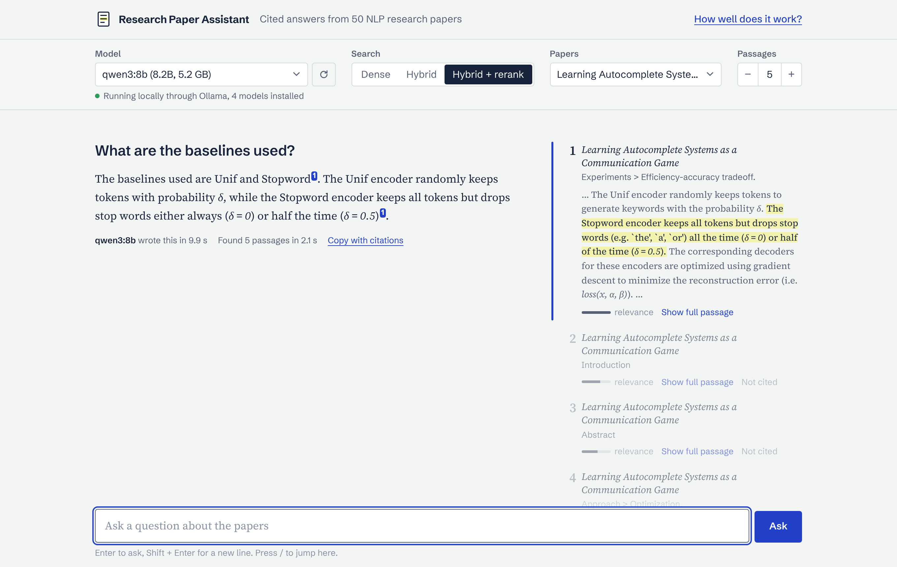
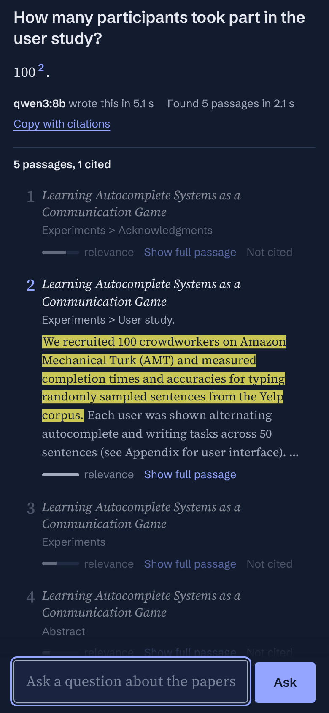
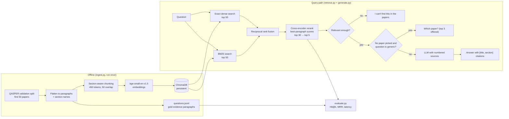

# Research Paper RAG Assistant

Ask questions about 50 NLP research papers and get answers where every claim is cited as
**[paper title, section]**. Under the hood: section-aware chunking, ChromaDB, hybrid
BM25 + dense retrieval with reciprocal rank fusion, a cross-encoder reranker, and an
evaluation harness that measures retrieval quality on 144 human-labelled questions
from the [QASPER](https://huggingface.co/datasets/allenai/qasper) dataset.

**Round 2 (Nov 2026)** re-checked everything on papers the system had never seen, measured whether citations actually support the answers, and hardened the service. See [Round 2](#round-2-nov-2026-what-changed-and-what-was-measured) for the before/after table, and [docs/EVALUATION.md](docs/EVALUATION.md) for the details.

**Run it yourself:** `uvicorn server:app` after `python ingest.py` (see [Run it locally](#run-it-locally)). There's no hosted demo yet: see [Deploy](#deploy).



### The web app

`uvicorn server:app` serves a single-page UI (plain HTML/CSS/JS in `static/`, no build step) on top of a small FastAPI API:

- **Pick any local model.** The model menu lists whatever is installed in your Ollama right now (`/api/tags`), plus any API provider you've configured, plus a no-LLM fallback. You can switch per question. If Ollama isn't running, the menu says so and how to start it.
- **Streaming.** The passages appear in the margin as soon as retrieval finishes (about 2 s). Then the answer streams in token by token over Server-Sent Events.
- **Citations you can check.** `[n]` markers become footnote numbers. Hovering one lights up its passage in the margin, and the sentence in that passage that best supports the answer gets highlighted. Uncited passages fold away. "Copy with citations" copies the answer in the `[paper title, section]` format.
- **Honest refusals.** When it declines, it says why: nothing relevant was found (and no model was asked), the model found no answer in the passages, or the answer came without any source.
- **"Which paper?"** A question like "What was the baseline?" asked across all papers usually has no single answer, so instead of answering from whichever paper ranks first, the app offers the most likely papers as buttons and re-asks with the one you pick.
- **Operable.** `/healthz` and `/readyz` (index, reranker and LLM checked separately), an `X-Request-ID` on every response and in every streamed event, one JSON log line per question with per-stage timings, optional API-key auth (`API_KEYS`), bounded concurrent generations, and timeouts on every LLM call.
- **Search controls.** Dense / hybrid / hybrid + rerank, a single-paper filter, the number of passages, and a "How well does it work?" panel that reads the numbers straight from `results/`.
- **Light and dark** themes follow the system, the layout works down to phone width (sources fold under each answer), keyboard focus is visible, and reduced motion is respected. The fonts (Source Serif 4, Schibsted Grotesk) are self-hosted, so the page makes no third-party requests.

The answer path is `generate.answer_events()`. It uses the same retrieval, refusal floor and citation repair that `evaluate.py` scores, so the demo and the benchmark can't drift apart.



## Round 2 (Nov 2026): what changed and what was measured

**Main weaknesses found**

1. **No clean held-out set.** Round 1's test papers (the ones the app serves) had also been used to pick the chunk size and to compare answer prompts.
2. **"100% citation accuracy" only checked that `[n]` pointed at a retrieved passage.** It said nothing about whether the passage supports the sentence.
3. **Corpus-wide retrieval was weak, and nobody knew why.** It turned out most misses are generic questions ("What baselines do they use?") that don't identify a paper at all, not retrieval errors.
4. **Results drifted between identical runs.** Chroma's approximate dense search returned different top-50 lists from one process to the next for 59 of 109 dev questions.
5. **Fragile service.** A missing index crashed start-up. The Ollama call had one 120 s timeout and no handling of malformed or cut-off streams. There was no readiness check, no request tracing, and nothing stopped an abandoned request from generating to the end.
6. **No CI, no ingestion consistency checks, no deployment path beyond a paid Hugging Face Space.**

**Before and after.** Round-1 numbers are as documented in Oct 2026 (app papers). Round-2 retrieval numbers are on the **final** split (validation papers 100-149: 209 questions, opened once after every choice was frozen on the dev split) unless marked "app".

| Area | Round 1 | Round 2 | Status |
|---|---|---|---|
| Evaluation protocol | test = app papers, also used for some choices | dev papers 50-99 for every decision; final papers 100-149 opened once | done |
| Paper-scope Hit@5 / MRR (hybrid + rerank) | 84.7% / 0.564 (app) | **85.2% / 0.593** (final); 84.7% / 0.565 (app) | measured |
| Corpus-wide Hit@5 / MRR | 47.9% / 0.304 (app) | **45.0% / 0.305** (final); 48.6% / 0.304 (app) | measured |
| Corpus-wide Hit@5 on questions answered directly (generic ones get "which paper?") | - | **70.7%** (final, 75 of 209 questions) | measured |
| Retrieval latency, p50 / p95 | 2.1 s / - (paper), 2.6 s / - (corpus); 4-core ARM | **1.11 / 1.92 s** (paper), **1.82 / 2.46 s** (corpus); 2-core x86. Round-1 scoring on the same machine: 2.55 / 3.63 s, 3.61 / 4.33 s | measured |
| Repeatability | dense results differed between processes for 59/109 dev questions | 0/109 | measured |
| Citations | "100% citation accuracy" (valid markers) | **80.4%** of cited claims supported by their passages (manual review, final); valid markers still 100% | measured |
| Answer correctness (qwen3:8b) | token F1 0.385 (30 app questions) | **60.9%** correct, 87.0% correct or partial (23 final questions, reviewed); token F1 0.354 | measured; different question sets |
| Refusals | 10/10 off-topic | off-topic 4/4; ambiguous 4/4 asked "which paper?"; unanswerable 3/10 refused, 6/10 acceptable | measured |
| Multi-paper questions | not tested | **0/4** handled (retrieval returns one paper) | measured: open problem |
| Failure handling | see weakness 5 | health/readiness checks, typed LLM errors, connect/read/total timeouts, malformed and cut-off stream detection, disconnect stops generation, bounded concurrency, request IDs | tested (fake Ollama server, 63 tests) |
| Indexing | delete + re-add every run | manifest hash: no-op when unchanged, atomic swap when not, never duplicates, refuses an index from another embedding model | tested |
| CI | none | GitHub Actions: lint + offline tests, retrieval regression gate, Docker build + readiness | **written, not run on GitHub in this session** |
| Container | builds index at build time | models + data baked in, offline at runtime, health check, non-root | **not built in this session** (registry unreachable) |
| Cloud deployment | HF Spaces notes (paid) | Cloud Run / VM guide with auth, secrets, monitoring, rollback | documented, **not deployed** |

**Changes, and why**

| Change | Why (evidence) |
|---|---|
| New dev/final splits by paper; `ingest.py --split`, `evaluate.py --split` | separate tuning from reporting; the old test set was partly used for tuning |
| Exact dense search (NumPy) instead of Chroma HNSW | 59/109 dev questions got different results across processes; exact is deterministic and ~20 ms at this size |
| Reranker scores each chunk by its best paragraph only (`maxp`) | half the latency (p50 2.5 → 1.1 s); dev: −1 question in each scope; final: −0.013 MRR, Hit@5 +1.0 / −0.9 points |
| "Which paper?" for generic corpus-wide questions | 70% of corpus-wide misses were wrong-paper misses on generic questions; for those, the top paper was right only 19% of the time (dev) |
| Paper-reference markers (`BIBREF3`) stripped from shown answers | copied into answers on dev; prompt instructions didn't stop it |
| Answer evaluation with claim-level support review, judge, refusal categories (`answer_eval.py`) | the old citation metric hid unsupported claims |
| Reliability work in `server.py` / `generate.py` | each item is covered by a test that fails without it |
| Index manifest, atomic rebuild | repeatable indexing without duplicates; catches embedding-model mismatch |

**Tried and rejected on dev:** rerank depth 50 (+2 questions for +45% latency), weighted RRF, two "paper boost" re-rankings (help specific questions, hurt generic ones more), capping reranker inputs at 256 tokens (+7% speed only), and prompt v3 (didn't fix its target failures and broke one correct answer). Details and numbers: [docs/EVALUATION.md](docs/EVALUATION.md).

**Limitations:** the answer set is small (24 answerable questions on final), all manual labels were made by an AI reviewer (Claude) rather than a person, the automated judge (qwen3:14b) shares the generator's model family, and multi-paper questions remain unsolved. Files for all of it are under `results/v2/` ([index](results/v2/README.md)); setup and commands are in [docs/REPRODUCIBILITY.md](docs/REPRODUCIBILITY.md).

## Round-1 results (Oct 2026, kept for reference)

> These are the original numbers, unchanged. The "test" questions below are the app's own 50 papers, which were also used to compare chunk sizes and to re-run answer prompts, so treat them as optimistic. The round-2 final split above is the clean held-out comparison.

Retrieval quality on **144 questions** over the **50-paper / 1,083-chunk** index. A retrieved
chunk counts as correct when it contains one of the paragraphs the QASPER annotators marked
as evidence. MRR is computed over the top 5.

**Paper scope.** The search is limited to the paper the question was asked about (the "Limit to one paper" filter in the app). This is the setting QASPER was built for.

| Retrieval mode | Hit@1 | Hit@3 | Hit@5 | MRR | Median latency (s) |
|---|---|---|---|---|---|
| Dense (bge-small) | 31.9% | 59.7% | 72.9% | 0.468 | 0.012 |
| Hybrid (BM25 + dense, RRF) | 31.9% | 61.1% | 75.7% | 0.480 | 0.013 |
| **Hybrid + cross-encoder rerank** | **41.0%** | **68.1%** | **84.7%** | **0.564** | 2.146 |

**Corpus scope.** The search covers all 50 papers at once. This is much harder, because many QASPER questions
("What baselines do they compare to?") never say which paper they mean.

| Retrieval mode | Hit@1 | Hit@3 | Hit@5 | MRR | Median latency (s) |
|---|---|---|---|---|---|
| Dense (bge-small) | 14.6% | 26.4% | 34.7% | 0.214 | 0.012 |
| Hybrid (BM25 + dense, RRF) | 16.7% | 29.9% | 36.1% | 0.238 | 0.012 |
| **Hybrid + cross-encoder rerank** | **20.8%** | **36.8%** | **47.9%** | **0.304** | 2.627 |

**Takeaways**

- Hybrid + rerank lifts **Hit@5 from 72.9% → 84.7%** in paper scope and **34.7% → 47.9%** in corpus scope (+38% relative). MRR goes from 0.468 to 0.564.
- BM25 on its own adds a modest gain (+1.4 to +2.8 Hit@5 points). The cross-encoder accounts for most of the improvement.
- The reranker costs about 2–2.5 s per query on a 4-core CPU, and a GPU or Apple's MPS cuts that a lot. `rerank_candidates` in `config.py` trades speed for recall.

### How the reranker was tuned (without overfitting the benchmark)

The first version of the reranker (whole-chunk scoring, top 20) reached 80.6% / 43.8% Hit@5. Tuning more knobs on the same 144 questions would just fit those 144 questions. So `experiments.py` uses a separate **dev set**, QASPER validation papers 50–99 (109 questions, never shown to the app). It picks every setting there and only then reports on the 144 test questions.

Three changes held up on dev and were kept:

1. **Best-passage scoring (MaxP).** A 450-token chunk is a lot for a cross-encoder trained on short MS MARCO passages, and one relevant sentence gets diluted. Each chunk is also split into paragraph-sized passages, and the chunk's score becomes the better of its whole-chunk score and its best-passage score.
2. **Prior fusion.** The reranked order is blended (RRF, weight 0.5) with the first-stage hybrid order. A noisy cross-encoder score then can't bury a chunk that both BM25 and dense search ranked highly.
3. **Rerank depth 30** instead of 20.

| | Dev Hit@5 (paper / corpus) | Test Hit@5 (paper / corpus) | Test MRR (paper / corpus) |
|---|---|---|---|
| Original reranker | 87.2% / 46.8% | 80.6% / 43.8% | 0.536 / 0.285 |
| **Tuned reranker** | **89.9% / 50.5%** | **84.7% / 47.9%** | **0.564 / 0.304** |

The test gains (+4.1 points in both scopes) are close to the dev gains (+2.7 / +3.7), which suggests they're real rather than noise. Full grid: `results/ablation.md` and `results/ablation_all.csv`. One idea helped only without the reranker. Fusing passage-level dense and BM25 rankings into the first stage (`hybrid_maxp_dense_heavy`) beats plain hybrid on its own, but with the cross-encoder on top, plain hybrid candidates did better on dev, so that is what the app uses.

**Chunk-size experiment** (original reranker):

| Chunk size | Hit@5 (paper) | MRR (paper) | Hit@5 (corpus) | MRR (corpus) |
|---|---|---|---|---|
| 256 tokens | 75.0% | 0.496 | 43.1% | 0.285 |
| **450 tokens** (default) | **80.6%** | **0.536** | **43.8%** | 0.285 |

Bigger chunks win in paper scope. QASPER evidence is often spread across neighbouring sentences, and a 256-token window cuts it apart.

### Answer quality

Same 30 sampled questions (seed 42) plus 10 off-topic ones, all with the tuned reranker, qwen3:8b running in Ollama on a MacBook Pro:

| Generator | Token F1 | Citation accuracy | Refused (answerable Qs) | Refused (off-topic Qs) | Median generation time |
|---|---|---|---|---|---|
| Extractive baseline (no LLM) | 0.151 | 100% | 0% | 90% | < 1 ms |
| qwen3:8b, prompt v1 | 0.297 | 100% | 3% (1/30) | 100% | 10.9 s |
| **qwen3:8b, prompt v2 + citation repair** | **0.385** | **100%** | **0%** | **100%** | 10.1 s |

The prompt was chosen on the dev papers too (`results/answers_ablation.md`):

| On dev (papers 50–99) | Token F1 | Refused (answerable) |
|---|---|---|
| v1 | 0.254 | 10% |
| v2 (answer-first) | 0.318 | 10% |
| v2 + citation repair | 0.324 | 7% |

What changed, and why:

- **Answer-first prompt (v2).** The v1 answers were correct but wordy. QASPER references are short ("100", "Yes", "Unif and Stopword"), and so is what a reader wants first. v2 asks for the shortest direct answer, using the sources' own terms, followed by an optional sentence of support. It also says outright that a source answering *in other words* counts. (The old "how many participants?" miss, where the source said "100 crowdworkers", is gone with both prompts once the tuned retriever is in place; v2's answer is simply "100 [2]".)
- **Citation repair.** Sometimes the model gives the right answer but copies the paper's own reference marker ("based on RoBERTa BIBREF2.") instead of a source number. The old code treated that as an unsupported answer and refused. Now the model gets one follow-up turn asking it to cite a numbered source or say it can't. On dev that rescued one answer. On test it never fired. It costs an extra LLM call only in that case, and the code never adds a citation itself.
- **Refusals still work.** The reranker floor (`MIN_RERANK_SCORE`, re-calibrated to −9 for the new scoring) stops 9 of the 10 off-topic questions before any LLM call. The LLM refuses the 10th on its own, which is why the extractive baseline, with no LLM, only gets 9/10.
- **Token F1 is harsh.** It compares words with a short reference span, so a correct answer plus one sentence of context still scores well below 1. Treat it as a relative measure between versions.

Files: `results/answers_ollama_v{1,2}.csv` (per question) and `results/answers_summary_*.csv`. `python evaluate.py --skip-retrieval --answers 30 --provider ollama` regenerates them; `PROMPT_VERSION=v1` or `CITE_REPAIR=0` turns the changes off. The first-round run (old retriever, v1 prompt, F1 0.300) is kept in `results/history/`.

## How it works



The app and the evaluation script call the **same** `Retriever.retrieve()` function, so the reported scores are the scores of the system people actually use.

- **Chunking (`ingest.py`).** Text is split per section and never across sections or papers. Chunk size is measured with the embedding model's own tokenizer, so chunks really fit in its 512-token window. Character offsets preserve the original casing. Each chunk records which paragraphs it holds, which is how evaluation stays automatic.
- **Retrieval (`retrieve.py`).** Dense search is an exact cosine search over the bge-small vectors stored in Chroma (round 2; it used Chroma's approximate HNSW search before, which wasn't repeatable), with the query instruction prefix the model was trained with. BM25 uses `rank_bm25` over the same "title. section. text" string. The two ranked lists are merged with reciprocal rank fusion (k = 60). RRF uses only ranks, so the two very different score scales never need to be normalised against each other. Reranking uses `cross-encoder/ms-marco-MiniLM-L-6-v2` on the top 30. Each chunk is scored by its best paragraph (round 1 also scored the whole chunk and kept the better of the two; round 2 dropped that for speed), and that order is blended back with the hybrid order.
- **Generation (`generate.py`).** The LLM sees the chunks as numbered sources and must cite `[n]` after each claim. Small models get numbers right far more often than long titles. The code then rewrites `[n]` as `[paper title, section]` and drops any citation that doesn't match a retrieved chunk. The system says *"I can't find this in the papers"* in three cases: the reranker's best score is below a calibrated floor, the model says so, or the model still has no valid citation after one repair turn.
- **LLM backends.** Ollama (free, local), any OpenAI-compatible API (OpenAI, Groq's free tier, …), Anthropic, or an **extractive** fallback that quotes the best sentences and needs no key at all. `LLM_PROVIDER=auto` picks whatever is configured.

## Run it locally

Requires Python 3.10+ and about 2 GB of disk (PyTorch plus ~230 MB of models). CPU only.

```bash
git clone <your-repo-url> && cd RAG_Project
python -m venv .venv && source .venv/bin/activate
pip install -r requirements-dev.txt     # or requirements.txt without the test tools

cp .env.example .env          # then pick an LLM (see below), or leave it on auto

python ingest.py              # download QASPER + models, build the index (~2 min on a laptop; re-runs are no-ops)
python evaluate.py            # retrieval eval -> results/results.csv, results.md
uvicorn server:app            # open http://localhost:8000
# (the simpler Streamlit page still works: streamlit run app.py)
```

Other useful commands:

```bash
python generate.py "Which datasets are used for Armenian NER?"   # ask from the terminal
python retrieve.py "BLEU on Europarl" --mode hybrid               # inspect raw retrieval
python ingest.py --chunk-size 256 --chunk-overlap 32               # build a second index...
python evaluate.py --chunk-size 256                                # ...and compare it
python evaluate.py --modes hybrid_rerank --scopes paper            # re-run one row only
python evaluate.py --skip-retrieval --answers 30                   # answer quality with your LLM
python experiments.py                                              # dev/test retrieval ablation (cached, resumable)
python experiments.py --budget 150                                 # ...or in 150-second slices on a slow machine
pytest -q                                                          # 63 tests (most need no index, models or LLM)

# round 2
python ingest.py --split dev && python ingest.py --split final     # the tuning and held-out papers
python evaluate.py --split dev --out results/v2/dev/mine           # retrieval on dev
python failure_analysis.py --split dev --results results/v2/dev/mine
python bench.py --split dev --limit 60                             # per-stage latency, p50/p95
python answer_eval.py retrieve --set eval/answer_set_dev.jsonl --out results/v2/answers/mine
python answer_eval.py generate --out results/v2/answers/mine --provider ollama --model qwen3:8b
curl localhost:8000/readyz                                         # what's loaded and reachable
```

Full commands, versions and file checksums: [docs/REPRODUCIBILITY.md](docs/REPRODUCIBILITY.md).

The ablation works with other models too, e.g. on a machine with a GPU or Apple silicon:
`EMBED_MODEL=BAAI/bge-base-en-v1.5 RERANK_MODEL=BAAI/bge-reranker-base python experiments.py`
(rebuild the index with the same `EMBED_MODEL` before the app uses it).

**Picking an LLM**

| Option | Cost | Setup |
|---|---|---|
| Ollama (local) | free | install [Ollama](https://ollama.com) and `ollama pull qwen3:8b` (or any chat model). The web app finds installed models on its own; for the CLI and `evaluate.py`, set `LLM_PROVIDER=ollama` |
| Groq (hosted, OpenAI-compatible) | free tier | `OPENAI_API_KEY=<groq key>`, `OPENAI_BASE_URL=https://api.groq.com/openai/v1`, `LLM_MODEL=` any model from Groq's current list |
| OpenAI / Anthropic | a few cents for the whole eval | set `OPENAI_API_KEY` or `ANTHROPIC_API_KEY` |
| Extractive | free | nothing; this is the fallback when no LLM is configured |

## Deploy

[docs/DEPLOYMENT.md](docs/DEPLOYMENT.md) is a step-by-step path for Google Cloud Run or any Docker host: sizing, using a hosted LLM API (Ollama doesn't run there), API-key or platform authentication, secrets in a secret manager, the JSON request logs and which alerts to set on them, and rollback by revision. Nothing has been deployed, and the guide says where costs start.

The image (`docker build -t paper-rag .`) contains the models, the dataset file and the built index, starts without network access, and exposes `/healthz` and `/readyz` for probes. The README header is also a Hugging Face Spaces config, but Docker Spaces need a paid (PRO) plan as of Oct 2026.

## Project structure

```
config.py          all settings (models, chunk size, paths, LLM, timeouts, auth), overridable via env/.env
ingest.py          QASPER -> paragraphs -> chunks -> embeddings -> ChromaDB (+ questions); --split app|dev|final; manifest-checked, atomic
retrieve.py        dense / BM25 / RRF hybrid / cross-encoder rerank behind one retrieve()
generate.py        prompt, LLM backends, citation rewriting, refusal logic, CLI
evaluate.py        Hit@1/3/5, MRR, right-paper@5, p50/p95 latency per mode & scope (--split, --out, --ce-cache)
failure_analysis.py  why corpus-wide misses happen (wrong paper / not a candidate / misranked / unreachable)
answer_eval.py     answer correctness, claim support, citation coverage, refusals (stages: retrieve, generate, judge-jobs, review-sheet, score)
bench.py           per-stage retrieval latency (dense, BM25, fusion, rerank), p50/p95, with machine details
experiments.py     dev-tuned / test-reported retrieval ablation (MaxP, fusion, rerank depth, prior)
server.py          FastAPI app: streaming /api/ask (SSE), /healthz, /readyz, request ids, JSON logs, auth, back-pressure
static/            the web UI: index.html, app.css, app.js (no framework, no build step), fonts
app.py             the original Streamlit UI (still works, simpler)
tests/             63 tests: logic, API with a fake LLM, failure handling against a fake Ollama server,
                   ingestion consistency, answer-eval helpers, retrieval regression gate (golden/)
eval/              round-2 answer sets, review labels, question specificity labels, browser relay runner
scripts/           download_assets.py (models + data for offline use), check_determinism.py
docs/              EVALUATION.md, REPRODUCIBILITY.md, DEPLOYMENT.md, screenshots
.github/workflows/ CI: lint + offline tests, retrieval regression, Docker build + readiness
data/questions.jsonl   the 144 evaluation questions with gold evidence paragraph ids
results/           round 1 (unchanged): results.csv/.md, ablations, answer checks; round 2 under results/v2/
Dockerfile         CPU-only image: models baked in, offline runtime, health check, non-root
```

## Notes and decisions

- **Why QASPER?** It gives full paper text *and* questions with annotated evidence paragraphs, so retrieval can be scored automatically with no hand labelling. 156 questions belong to the first 50 validation papers. 5 of them are unanswerable, 6 have only figures or tables as evidence, and 1 has evidence that doesn't map to a paragraph, which leaves 144.
- **Loading QASPER.** `allenai/qasper` is an old script-based dataset, and recent `datasets` versions refuse to run it. `ingest.py` reads the Hub's auto-converted Parquet file (`refs/convert/parquet`) instead.
- **Scoring is strict.** Thanks to the 50-token overlap, a chunk may hold the tail of the previous paragraph. A chunk only "claims" a paragraph when it holds at least half of it (or at least 100 of its tokens), so overlap can't inflate hit rates.
- **Reproducibility.** Dependencies are pinned, the corpora are fixed slices (no random sampling), samples use fixed seeds, LLM calls use temperature 0, dense search is exact, and each index carries a manifest hash of its contents. See [docs/REPRODUCIBILITY.md](docs/REPRODUCIBILITY.md).
- **Latency.** Round 1 was measured on a 4-core ARM Linux VM, round 2 on a 2-core x86 VM (`bench.py` prints the conditions with the numbers). Compare settings measured on the same machine only.

## What I'd try next

- **Multi-paper questions.** Diversify the passages for explicitly cross-paper questions (e.g. at most two per paper, eight in total) and re-run the multi-paper set; today it fails 4/4 because retrieval returns one paper.
- **Unsupported claims.** 4/10 unanswerable questions got confident, cited, unsupported answers. A per-sentence entailment check (NLI model or the judge prompt) before showing an answer could drop or flag those sentences; measure it against `eval/review_final.json`.
- **A human pass over the review labels** (`results/v2/answers/final/review_sheet.md`) and a larger answer set.
- **A bigger corpus and a better embedder** (bge-base, e5), plus parent-document retrieval for long sections.
- **A larger local LLM** (e.g. qwen3:14b) on a machine with more memory, run through the same dev/test split as the prompt comparison.

## Licence and credits

Code: MIT. QASPER is © AllenAI, released under CC BY 4.0 (Dasigi et al., 2021, [arXiv:2105.03011](https://arxiv.org/abs/2105.03011)).
Models: [BAAI/bge-small-en-v1.5](https://huggingface.co/BAAI/bge-small-en-v1.5), [cross-encoder/ms-marco-MiniLM-L-6-v2](https://huggingface.co/cross-encoder/ms-marco-MiniLM-L-6-v2).
